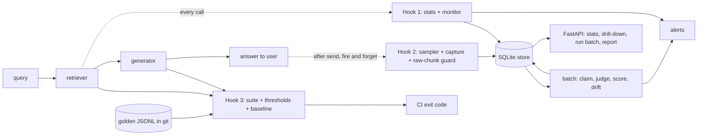

# rag-quality-monitor

Evaluate a RAG system across four dimensions, with three hooks that say where each check runs.

> An open-source reference implementation of four-dimension RAG evaluation with a three-hook model. All names and data are fictional.

[](https://github.com/Tayyab-Bilal/rag-quality-monitor/actions/workflows/ci.yml)

## At a glance

**What it is.** A small Python library that checks how good a RAG system is, along four dimensions: retrieval, answer generation, offline regression and a golden dataset. It splits the checks into three hooks, so each one runs where its cost and its evidence fit.

**What is built** (in this repo, working and tested)

- Retrieval metrics: Recall@k, precision@k, hit rate, MRR, nDCG@k. Pure functions, no LLM. `metrics/retrieval.py`: `recall_at_k`, `precision_at_k`, `hit_rate`, `mrr`, `ndcg_at_k`.
- Answer metrics: faithfulness with per-claim verdicts, answer relevance, context precision, context recall. `metrics/generation.py`: `faithfulness`, `answer_relevance`, `context_precision`, `context_recall`.
- Judge adapters: a `Judge` and `Embedder` interface, deterministic fakes for tests, and optional Anthropic and OpenAI adapters. `judge/base.py`: `Judge`; `judge/fake.py`: `FakeJudge`; `judge/anthropic_judge.py`: `AnthropicJudge`; `judge/openai_judge.py`: `OpenAIJudge`; `judge/env.py`: `judge_from_env`.
- Hook 1, heuristics on every query: score gap, empty results and p95 latency alerts over a rolling window. `hook1/monitor.py`: `instrument`, `RetrievalMonitor`; `hook1/stats.py`: `retrieval_stats`.
- Hook 2, sampled judge on live traffic: per-route sampling, a guard that rejects non-raw contexts, batch scoring with a judge-call cap, and drift alerts. `hook2/sampler.py`: `Sampler`; `hook2/capture.py`: `SampleCapture`, `check_raw_chunks`; `hook2/batch.py`: `run_batch`; `hook2/drift.py`: `check_drift`.
- Hook 3, the CI gate: loads golden JSONL, runs the suite, checks thresholds, compares with a saved baseline report, and exits non-zero on a failure. `hook3/golden.py`: `load_golden_dir`; `hook3/runner.py`: `run_suite`; `hook3/thresholds.py`: `check_thresholds`, `find_regressions`; `suite.py`: `main`.
- The CI workflow runs ruff, pytest, the demo, and then the suite against the committed `examples/baseline.json`. `.github/workflows/ci.yml`.
- A tenant-scoped SQLite store and a small FastAPI app. `store.py`: `Store`; `api.py`: `create_app`.

**What is not built, or is simplified here**

- The judge in tests and the demo is a fake word-overlap heuristic. It makes runs repeatable. It is not a quality signal.
- The adapters for real LLM judges are tested only with fake clients. No test or demo calls a live model.
- Gap collapse uses a fixed threshold per route. It does not learn it from a healthy baseline.
- The text check for an intermediate answer cannot catch a paraphrase. Provenance (`retrieved=`) is the real guard.
- Capture is an in-process task cap, not a durable queue. A crash can lose in-flight samples, and overflow is dropped and counted.
- The judge cost cap is checked between samples, so a batch can overshoot it by one sample.
- Drift compares batch means with no significance test, so small batches are noisy.
- The example pipeline (`examples/acme_rag.py`) and the golden sets are small fictional data.

**The Three-Hook Model in 3 lines**

- Hook 1, every query, no LLM: record score stats and alert on collapse, empty results and slow p95. In `hook1/`.
- Hook 2, a sample of live traffic, judged in the background, no labels needed: faithfulness, relevance, context precision, drift. In `hook2/`.
- Hook 3, every PR or nightly, golden set with labels: thresholds and regression against a baseline, exit code gates CI. In `hook3/` and `suite.py`.

**Run it**

```bash
.venv/bin/pytest -q
```

Current result: 165 passed. No network and no API keys needed. `.venv/bin/python examples/demo.py` prints the full three-hook story.

## How each part works, one by one

Plain-English walk through the seven mechanisms that make this repo work. Each one says what goes wrong without it, how it works, and which tests prove it.

### 1. Retrieval metrics and claim-level faithfulness

- **Risk / problem:** One averaged score hides what went wrong. A retriever can quietly lose the right chunk, or an answer can contain one invented sentence, and a single number never says which.
- **How it works:**
  - The retrieval scores compare the ids the retriever returned against the ids a human labelled as relevant. No model is involved, so the same input always gives the same number (`metrics/retrieval.py: recall_at_k`, `ndcg_at_k`).
  - The edge cases are decided up front. A duplicate id counts once, a short result list is still divided by k so a retriever that returns too little is punished, and a case with no labelled chunk raises an error instead of returning a flattering score (`metrics/retrieval.py: _check`).
  - Faithfulness splits the answer into separate claims, asks the judge whether the retrieved chunks support each one, and scores the share that are supported. The verdict for every claim is kept, so you see the exact unsupported sentence, not just a mean (`metrics/generation.py: faithfulness`).
  - An answer with no claims gets no score, not a perfect one. Answer relevance does the same when no questions come back, so missing evidence never looks like a good or bad result (`metrics/generation.py: answer_relevance`).
  - Context precision is rank aware. A relevant chunk at rank one scores better than the same chunk at rank five (`metrics/generation.py: context_precision`).
- **Tests that prove it:** `tests/test_retrieval_metrics.py`: `test_no_relevant_ids_is_an_error_not_a_score`, `test_precision_divides_by_k_when_fewer_results_come_back`, `test_duplicates_count_once`, and 8 more in that file. `tests/test_generation_metrics.py`: `test_faithfulness_keeps_per_claim_verdicts_and_unsupported_claims`, `test_faithfulness_with_no_claims_has_no_score`, `test_context_precision_is_rank_aware`, and 5 more in that file.

### 2. The judge interface and its adapters

- **Risk / problem:** If the metrics are tied to one provider, every test needs a live model and a provider change rewrites the code. A judge that returns junk can also poison scores without anyone noticing.
- **How it works:**
  - The metrics only talk to a small judge interface and an embedder interface. Tests plug in a fake judge, so nothing needs a network or a key (`judge/base.py: Judge`).
  - The real Anthropic and OpenAI adapters share one base. They ask for JSON and check the reply against a schema, and a bad reply, a refusal or a cut-off reply becomes a clear judge error rather than a silent zero (`judge/llm.py: parse_json`).
  - If the judge returns the wrong number of verdicts for the claims, that is an error too. If it cites a chunk id that was never in the prompt, the id is dropped so an invented source never counts as evidence (`judge/llm.py: LLMJudge.verify_claims`).
  - The fake judge is only a word-overlap heuristic, so it keeps runs repeatable but says nothing about real quality. The adapters are tested with fake clients only (`judge/fake.py: FakeJudge`).
- **Tests that prove it:** `tests/test_adapters.py`: `test_anthropic_judge_verify_claims_maps_verdicts_and_drops_invented_chunk_ids`, `test_anthropic_judge_wrong_number_of_verdicts_is_a_judge_error`, `test_anthropic_judge_refusal_is_a_judge_error`, and 14 more in that file.

### 3. Hook 1: free heuristics on every query

- **Risk / problem:** Retrieval can go bad slowly. Scores flatten, results come back empty or search gets slow, and nobody sees it until users complain.
- **How it works:**
  - A wrapper around the retriever records the score spread, the number of chunks and the latency of every call. It needs no judge, so it costs almost nothing (`hook1/monitor.py: instrument`).
  - The main signal is the score gap, the top score minus the last score in the top k. If every chunk scores about the same, the retriever has lost its ability to tell good from bad, even while the right chunk is still in the list and a judged precision score looks fine (`hook1/stats.py: retrieval_stats`).
  - A rolling window of the last 200 calls per tenant and route feeds three alerts: collapsed gap (under 0.15), too many empty results (over 10 percent) and slow p95 latency (over 500 ms). Nothing alerts until the window has at least 20 calls, so a tiny sample cannot raise a false alarm (`hook1/monitor.py: RetrievalMonitor.check`).
  - If the monitor or the store breaks, the error is logged and the search result is still returned. A broken monitor must never take down search.
  - Simplification: the gap threshold is a fixed number per route, not learned from healthy traffic.
- **Tests that prove it:** `tests/test_hook1.py`: `test_gap_collapse_fires_while_relevant_chunk_is_still_in_top_k_and_judged_precision_misses_it`, `test_instrument_never_raises_when_the_store_is_broken`, `test_too_few_events_gives_no_verdict`, and 10 more in that file.

### 4. Hook 2: sampling, capture and the raw-context guard

- **Risk / problem:** Judging every query is too expensive, and the judge is only meaningful if it sees what the retriever really returned. If a pipeline logs an intermediate model's answer as the "context", the scores quietly compare one answer with another.
- **How it works:**
  - Whether a query is sampled depends on a hash of its sample id compared with the route's rate (2 percent by default, 100 percent for a sensitive route). The same id always gets the same decision, so replays and tests are repeatable (`hook2/sampler.py: Sampler.should_sample`).
  - Capture runs after the answer is sent, in a background task. It never blocks and never raises. If too many writes are waiting (1000 by default) the sample is dropped and counted, which is a stated simplification, not a durable queue (`hook2/capture.py: SampleCapture.capture`).
  - The guard runs before sampling, so a buggy pipeline shows up even at a 2 percent rate. The strongest check is provenance: every context must be a chunk the retriever really returned for this request, and with the full result the text must match too. A made-up id or an edited text is rejected and counted (`hook2/capture.py: check_raw_chunks`).
  - There is also a word-sequence overlap check as a secondary tripwire. It only flags, it never rejects, because a short FAQ chunk can honestly equal an extractive answer. It cannot catch a reworded answer, which is why provenance is the real guard (`hook2/capture.py: suspected_intermediate_answer`).
  - If the caller does not pass what the retriever returned, only the shape check and the tripwire run, and a counter shows how often provenance went unchecked.
- **Tests that prove it:** `tests/test_hook2_sampling.py`: `test_sampler_is_deterministic_per_sample_id`, `test_capture_does_not_block_the_caller_when_the_store_is_slow`, `test_queue_overflow_is_dropped_and_counted`, and 10 more in that file. Attack and guard tests in full: `test_sample_with_an_intermediate_answer_as_context_is_rejected`, `test_longer_specialist_answer_with_an_invented_id_is_rejected_by_provenance`, `test_two_sub_agent_answers_as_contexts_are_rejected`, `test_known_id_with_altered_text_is_rejected_when_the_full_result_is_given`, `test_short_faq_chunk_equal_to_the_extractive_answer_is_accepted_and_at_most_flagged`, `test_text_heuristic_cannot_catch_a_paraphrase`, `test_chunks_without_ids_are_not_raw_chunks`, `test_rejection_is_counted_even_when_the_sample_would_have_been_sampled_out`.

### 5. Hook 2: batch scoring, cost cap and drift

- **Risk / problem:** Scoring in the background can double-score a sample, run up an unbounded judge bill, lose work when a worker dies, or compare scores that came from different judges and call it drift.
- **How it works:**
  - A batch claims pending samples with one conditional database update that stamps them with a fresh token. The database serialises writers, so two batches racing each other can never score the same sample (`store.py: Store.claim_samples`).
  - A batch waits for at least 10 pending samples, unless the oldest has waited an hour. Samples claimed more than 10 minutes ago, from a crashed worker or a failed save, go back to pending first (`hook2/batch.py: run_batch`).
  - Every judge call is counted. At the cap (500 calls by default) the batch stops and puts the unprocessed samples back to pending. The check happens between samples, so a batch can overshoot by one sample. A judge error marks only that sample as failed and the batch carries on (`judge/base.py: CountingJudge`).
  - When faithfulness is 0.80 or lower, the unsupported claims are saved with the sample, so a low score comes with a reason.
  - Every batch carries a config hash built from the judge model, embedder, prompt version and metric set. Drift only compares batches with the same hash (`hook2/batch.py: config_hash`).
  - Drift compares a batch mean with the average of the last 10 earlier batches. It alerts when a metric is more than 15 percent below that average, and gives no verdict with fewer than 3 earlier batches. There is no significance test, so small batches are noisy (`hook2/drift.py: check_drift`).
- **Tests that prove it:** `tests/test_hook2_batch.py`: `test_batch_claim_is_atomic_across_racing_workers`, `test_cost_cap_leaves_the_remainder_pending`, `test_drift_alert_on_a_drop_larger_than_15_percent`, and 20 more in that file.

### 6. Hook 3: golden set, thresholds and the regression gate

- **Risk / problem:** Without a labelled set that runs in CI, nothing stops a bad change from merging. A gate that silently checks nothing is worse than no gate.
- **How it works:**
  - The golden set is plain JSONL files in the repo, one per route, so changes are reviewed in pull requests. A bad line fails with its line number (`hook3/golden.py: load_golden_dir`).
  - The suite runs the real retriever and generator over every case. It always computes the retrieval metrics, and it adds the judged ones when a generator and judge are given (`hook3/runner.py: run_suite`).
  - The two kinds of metric are gated differently. Retrieval metrics are exact, so they must meet their limit with no slack. Judged metrics get a small tolerance (0.05 by default), because even a judge at temperature zero is not fully repeatable (`hook3/thresholds.py: check_thresholds`).
  - A threshold on a metric that was not measured counts as a failure, and a threshold file with a typo, an unknown metric or no metrics is rejected. So the gate cannot quietly turn itself off.
  - The report is also compared with a saved baseline report. A metric that got worse fails the build even if it is still above its threshold. Judged metrics are only compared when the judge, embedder, prompt and golden set are the same (`hook3/thresholds.py: find_regressions`).
  - The command exits with 0 for pass, 1 for a failure or regression and 2 for a bad input file, and CI runs it against the committed baseline (`suite.py: main`).
- **Tests that prove it:** `tests/test_hook3.py`: `test_regression_vs_baseline_is_flagged_while_still_above_threshold`, `test_unmeasured_threshold_fails_instead_of_being_skipped`, `test_judged_metrics_use_a_tolerance_but_algorithmic_metrics_are_strict`, and 17 more in that file. Gate-hardening tests in full: `test_threshold_file_with_a_typo_key_is_rejected_instead_of_silently_ignored`, `test_threshold_file_that_defines_no_metrics_is_rejected`, `test_threshold_file_with_an_unknown_metric_name_is_rejected`, `test_check_thresholds_refuses_an_empty_gate`, `test_judged_regressions_are_skipped_when_the_baseline_used_another_config`.

### 7. The tenant-scoped store and API

- **Risk / problem:** One shared database means one forgotten filter shows tenant A's data to tenant B, and a caller who can name their own tenant or spending limit can read or spend someone else's.
- **How it works:**
  - Every store method requires a tenant id, and every query filters on it. Samples are keyed by tenant and sample id together, so two tenants can reuse the same id without clashing (`store.py: Store`).
  - The API takes the tenant from the verified bearer token. No query parameter or body field can set it, and a missing or invalid token gets a 401 (`api.py: create_app`).
  - A sample that belongs to another tenant gets the same 404 as one that does not exist, so the API does not even confirm that it exists.
  - The judge-call cap is server configuration. A request may lower it but can never raise it (`api.py: create_app`).
- **Tests that prove it:** `tests/test_api.py`: `test_tenant_b_cannot_read_tenant_a_sample`, `test_tenant_cannot_be_overridden_by_any_query_or_body_field`, `test_a_request_cannot_raise_the_servers_judge_call_cap`, and 7 more in that file. Also `tests/test_hook2_batch.py`: `test_batch_is_scoped_to_its_tenant`.

## The design

**Read the full design notes: [docs/design.md](docs/design.md).** This repo implements them.

### The problem

Most teams "add evaluation" by wiring a library behind an endpoint, running it a few times on
hand-picked examples and reporting an average. That gives a number, not a quality system. The same
failures keep showing up:

- Nothing fires automatically, so real traffic is never measured and users find the regressions.
- One averaged number hides which answer, or which claim, caused a drop.
- Everything is an LLM judgment. Nothing checks retrieval against a known answer.
- The judge sees the wrong input: an intermediate model's *answer* recorded as the "retrieved
  context", so context scores compare one answer with another.
- No golden set, so nothing runs in CI and nothing stops a bad change from merging.

The fix is not a better metric. It is being clear about *what* is evaluated and *where* each check runs.

### Four dimensions

A RAG answer can fail in two places (retrieval, generation) and you need two kinds of evidence (live
traffic, curated cases).

| # | Dimension | Question it answers | Needs a reference? | Where in this repo |
|---|---|---|---|---|
| 1 | **Chunk retrieval** | Did we fetch the right evidence, ranked well? | Optional | `metrics/retrieval.py`, `hook1/` |
| 2 | **Answer generation** | Is the answer grounded, and does it address the question? | No | `metrics/generation.py` |
| 3 | **Offline regression** | Did this change make quality worse? | Yes | `hook3/` |
| 4 | **Golden dataset** | What does "correct" look like for our corpus? | It is the reference | `examples/golden/*.jsonl` |

### The Three-Hook Model

```
                 ┌──────────────────────── every query ───────────────────────┐
  query ──► retrieve ──► generate ──► answer
               │            │
               ▼            ▼
        Hook 1: heuristics   Hook 2: sampled judge (async)        Hook 3: offline suite (CI)
        no LLM, ~free        1–5% of traffic (100% for            golden JSONL, thresholds,
        every query          sensitive routes), reference-free    run on every PR / nightly
```

| | Hook 1 heuristics | Hook 2 sampled judge | Hook 3 offline suite |
|---|---|---|---|
| Runs | every query | 1–5% (100% sensitive) | every PR / nightly |
| Cost | ~free | judge calls on samples | judge calls on golden set |
| Needs labels | no | no | yes (golden JSONL) |
| Catches | retrieval collapse, empty results, latency | ungrounded answers, irrelevant answers, quality drift on real traffic | regressions before merge |
| Misses | answer quality | issues outside the sample | traffic unlike the golden set |

No single hook is enough. Together they cover live retrieval, live answers and changes before they ship.

## What it does

(Short list. The mechanisms are explained in [How each part works, one by one](#how-each-part-works-one-by-one).)

- **Retrieval metrics** (`metrics/retrieval.py`): recall@k, precision@k, hit rate, MRR, nDCG@k.
  Pure and deterministic, with defined edge cases.
- **Judged metrics** (`metrics/generation.py`): faithfulness with per-claim verdicts, answer
  relevance, context precision (rank-aware), context recall.
- **Hook 1** (`hook1/`): per-query score statistics and the score gap, a wrapper that records every
  retrieval without ever raising, a rolling window per tenant and route, and alerts for gap collapse,
  empty results and p95 latency.
- **Hook 2** (`hook2/`): per-route deterministic sampler, fire-and-forget capture with a drop counter,
  a guard that rejects non-raw contexts, atomic batch claiming, a judge-call cost cap, claim
  attribution for low faithfulness, a config hash, and drift alerts against a rolling baseline.
- **Hook 3** (`hook3/`, `suite.py`): JSONL golden loader with line-numbered errors, a suite runner,
  strict thresholds for algorithmic metrics, tolerance for judged ones, comparison with the previous
  report, and a CLI whose exit code gates CI.
- **Judges** (`judge/`): `Judge` and `Embedder` Protocols, deterministic fakes, and optional real
  adapters for Anthropic and OpenAI (never used by tests or the demo).
- **Store and API** (`store.py`, `api.py`): one SQLite store where every query is tenant-scoped, and a
  FastAPI app that takes the tenant from the authenticated token.

## Quickstart

```bash
uv venv .venv && uv pip install -e ".[dev,api]"
.venv/bin/python examples/demo.py          # the full story, no network, no API keys
.venv/bin/pytest -q                        # the test suite
.venv/bin/python -m rag_quality_monitor.suite \
    --golden examples/golden --thresholds examples/thresholds.json   # Hook 3 as a CI gate
```

Real output from the demo (shortened):

```text
HOOK 1: heuristic retrieval monitoring (every query, no LLM)

healthy traffic: 40 queries
  mean score gap 0.608   empty rate 0%   p95 latency 12 ms
  judged context precision 1.00
  alerts: none

after scores were flattened: 40 queries
  mean score gap 0.012   empty rate 0%   p95 latency 12 ms
  judged context precision 1.00
  alerts: ['mean score gap 0.012 < 0.15']

HOOK 2: sampled online evaluation (async, reference-free)

batch  generator   scored  faithfulness  relevance  precision  drift
    1  healthy         10          1.00       0.43       1.00  no verdict yet
    4  healthy         10          1.00       0.43       1.00  ok
    5  degraded        10          0.63       0.25       1.00  ALERT

  [UNSUPPORTED] Every plan includes unlimited phone support for premium customers.
  claim attribution (faithfulness <= 0.80): ['Every plan includes unlimited phone support for premium customers.']
  an answer under an id the retriever never returned   -> rejected_not_raw_chunks

HOOK 3: offline regression suite (CI gate)

THRESHOLD FAILURES
  help: recall_at_k = 0.7 < 0.900
REGRESSIONS vs baseline
  help: recall_at_k 1.000 -> 0.700
```

### Reading the demo numbers

The demo uses the fake judge and fake embedder, so some numbers look low or odd on purpose.

- **Answer relevance (about 0.43 to 0.44 here, even for perfect answers).** The fake embedder is a hashed
  bag of words and the fake judge's "questions" are word lists from the answer. A short question shares
  only a few words with a longer answer, so cosine similarity is capped well below 1. What matters is the
  change (0.43 to 0.25 when the answer drifts), not the level. A real embedder reads higher.
- **precision@k is at most 0.2.** With one labelled relevant chunk and `k = 5`, the best possible value is
  1/5. It is reported, but it is not in `thresholds.json` for that reason.
- **Context precision stays at 1.00 when extra irrelevant chunks are retrieved.** It is an average
  precision: irrelevant chunks ranked *after* the relevant one do not lower it. It punishes the relevant
  chunk being late, not noise at the end of the list. That is also why it misses a gap collapse.
- **`answer_relevance` 0.2 in `thresholds.json`** is tuned to the fake judge (healthy runs are about 0.43,
  so it has slack). Re-tune the judged thresholds for a real judge before gating on them.

## Usage guide

The example pipeline (`examples/acme_rag.py`) stands in for your own retriever and generator. A
retriever is `async (tenant_id, query, k) -> RetrievalResult`; a generator is
`async (question, chunks) -> str`. More in [docs/usage.md](docs/usage.md), the API in
[docs/api.md](docs/api.md), and every formula in [docs/metrics.md](docs/metrics.md).

**Retrieval metrics against labelled chunk ids:**

```python
from rag_quality_monitor.metrics.retrieval import mrr, ndcg_at_k, recall_at_k

retrieved = ["c7", "c2", "c9", "c1", "c4"]
relevant = {"c2", "c8"}
print(recall_at_k(retrieved, relevant, 5), mrr(retrieved, relevant), round(ndcg_at_k(retrieved, relevant, 5), 3))
assert recall_at_k(retrieved, relevant, 5) == 0.5
assert mrr(retrieved, relevant) == 0.5
```

**Hook 1: wrap the retriever once, check the window on a schedule:**

```python
import asyncio
import sys

sys.path.insert(0, "examples")
from acme_rag import AcmeRag

from rag_quality_monitor import ListAlertSink, Store
from rag_quality_monitor.hook1 import Hook1Thresholds, RetrievalMonitor, instrument

sink = ListAlertSink()
monitor = RetrievalMonitor(Store(), sink)
retriever = instrument(AcmeRag(flatten_scores=True).retrieve, monitor, route="help")


async def traffic():
    for _ in range(25):
        await retriever("tenant-1", "How do I archive a project?", 5)


asyncio.run(traffic())
alerts = monitor.check("tenant-1", "help", Hook1Thresholds(min_score_gap=0.15))
print([a.message for a in alerts])
assert [a.kind for a in alerts] == ["score_gap_collapse"]
```

**Hook 2: capture after the answer is sent, score in batches:**

```python
import asyncio
import sys

sys.path.insert(0, "examples")
from acme_rag import AcmeRag

from rag_quality_monitor import Store
from rag_quality_monitor.hook2 import Sampler, SampleCapture, run_batch
from rag_quality_monitor.judge import FakeEmbedder, FakeJudge


async def main():
    store, rag = Store(), AcmeRag(hallucinate=True)
    capture = SampleCapture(store, Sampler(route_rates={"compliance": 1.0}))
    question = "How long are audit logs retained?"
    found = await rag.retrieve("tenant-1", question, 5)
    answer = await rag.generate(question, found.chunks)
    capture.capture("tenant-1", "compliance", question, found.chunks, answer, sample_id="s1", retrieved=found)
    await capture.drain()
    result = await run_batch(store, FakeJudge(), FakeEmbedder(), "tenant-1", "compliance", min_samples=1)
    sample = store.get_sample("tenant-1", "s1")
    print(result.batch.faithfulness_mean, sample["unsupported_claims"])
    assert sample["unsupported_claims"] and sample["faithfulness"] <= 0.8


asyncio.run(main())
```

**Hook 3: the golden set as a gate:**

```python
import asyncio
import sys

sys.path.insert(0, "examples")
from acme_rag import AcmeRag

from rag_quality_monitor.hook3 import check_thresholds, load_golden_dir, load_thresholds, run_suite
from rag_quality_monitor.judge import FakeEmbedder, FakeJudge

rag = AcmeRag()
golden = load_golden_dir("examples/golden")
report = asyncio.run(run_suite(golden, rag.retrieve, rag.generate, FakeJudge(), FakeEmbedder()))
violations = check_thresholds(report, load_thresholds("examples/thresholds.json"))
print(report.routes["help"].algorithmic["recall_at_k"], violations)
assert violations == []
```

## How it works



1. **Every query.** `instrument()` wraps the retriever. After each call it computes the score
   distribution and score gap from the chunks already in hand and writes one event. Failures are
   logged, never raised.
2. **After the answer is sent.** `SampleCapture.capture()` first checks the contexts are raw chunks,
   (with `retrieved=`, that each one is a chunk the retriever really returned), then asks the `Sampler` (a hash of the sample id against the route's rate), then schedules a
   background write. It returns immediately and never raises.
3. **In the background.** `run_batch()` claims pending samples with one atomic UPDATE, scores each one
   (faithfulness, answer relevance, judged context precision), stores per-sample scores and claim
   verdicts, keeps the unsupported claims when faithfulness is 0.80 or lower, writes a batch row with a
   config hash, and compares it with the last 10 batches of the same config.
4. **In CI.** `python -m rag_quality_monitor.suite` loads the golden JSONL, runs the pipeline,
   computes retrieval metrics and (with a judge) generation metrics, checks thresholds, compares with
   the previous report, and exits non-zero on a failure or regression.

## Design decisions

1. **Three hooks, not one evaluator.** Each check runs where its cost and its evidence fit: free
   heuristics on every query, a sampled judge on live traffic, labelled metrics before merge.
   *Rejected:* one "evaluate" endpoint that runs only when called.
2. **Record raw chunks, never an intermediate answer, and check provenance.** Pass `retrieved=` (the
   retriever's result, or its chunk ids) to `capture()`: any context the retriever did not return is
   rejected and counted in `rejected_not_raw_chunks`, and with a full result the text must match too.
   Contexts must also be chunks with ids. A word 3-gram text heuristic runs on every context as a
   secondary signal (`suspected_intermediate_answer`): it flags, never rejects, because a short FAQ chunk
   can legitimately equal an extractive answer, and it cannot catch a paraphrase. Provenance is the real
   guard. *Rejected:* trusting the caller, and a text-only check; the mistake is easy to make when
   retrieval sits behind sub-agents, and it silently turns context scores into answer-versus-answer
   comparisons.
3. **Keep verdicts, not just averages.** Per-sample scores and per-claim verdicts are stored; low
   faithfulness keeps the unsupported claims. *Rejected:* a stored mean, which cannot be acted on.
4. **Algorithmic metrics gate strictly, judged metrics gate with tolerance.** A judge is never fully
   deterministic. *Rejected:* one threshold style for both, which is either flaky or toothless.
5. **Golden sets are JSONL files in the repo, one per route.** They are reviewed in pull requests and
   run in a CI sandbox with no database. *Rejected:* golden rows behind an API.
6. **Deterministic sampling from the sample id.** The same id gets the same decision; sensitive
   routes sample at 100%. *Rejected:* a random draw, which makes replays and tests irreproducible.
7. **Atomic claiming.** One conditional UPDATE under a claim token, so concurrent batches cannot score
   the same sample. *Rejected:* select-then-update, which double-scores under a race.
8. **A config hash on every batch.** Judge model, embedder, prompt version and metric set. Drift only
   compares batches with the same hash; the suite report carries a hash too (plus a fingerprint of the
   golden set), and judged metrics are only compared with a baseline that has the same one.
   *Rejected:* comparing across judge, embedder or prompt changes.
9. **A cost cap in judge calls.** Judge cost grows with chunks times claims; a batch stops at the cap
   and returns the rest to pending. In the API the cap is server configuration: a request can lower it,
   never raise it. Samples whose worker died or failed to save are reclaimed after a lease (10 minutes).
10. **The tenant comes from the token.** Every store method requires a tenant id, and the API takes it
    from the verified identity, never from a query or body field.

## Testing

```bash
.venv/bin/pytest -q        # a few seconds, no network
.venv/bin/ruff check .
```

| Rule | Test |
|---|---|
| Metrics have known values and defined edge cases | `test_retrieval_metrics.py` |
| Faithfulness keeps verdicts; precision is rank-aware; relevance separates on and off topic | `test_generation_metrics.py` |
| Gap collapse fires while the right chunk is still in the top k and judged precision misses it | `test_hook1.py::test_gap_collapse_fires_...` |
| Instrumentation never raises and records every call | `test_hook1.py::test_instrument_...` |
| Sampling is deterministic; sensitive routes are 100% | `test_hook2_sampling.py` |
| Capture never blocks or raises; overflow is counted | `test_hook2_sampling.py::test_capture_...`, `test_queue_overflow_...` |
| An intermediate answer as context is rejected (shape and provenance); a legitimate short FAQ chunk is accepted | `test_hook2_sampling.py::test_*provenance*`, `test_sample_with_an_intermediate_answer_...`, `test_short_faq_chunk_...` |
| A failed save strands nothing: samples are reclaimed after the lease | `test_failed_save_strands_nothing_...` |
| Two batches never score the same sample (real thread race) | `test_batch_claim_is_atomic_across_racing_workers` |
| The cost cap leaves the rest pending; judge errors become `eval_failed` | `test_hook2_batch.py` |
| Drift: more than 15% drop alerts; under 3 baseline batches or another config hash does not | `test_hook2_batch.py::test_drift_...`, `test_no_...` |
| Golden errors carry line numbers; suite passes, fails, and flags regressions; CLI exit codes (0, 1, 2) | `test_hook3.py` |
| A threshold typo, an unknown metric or an empty file cannot silently disable the gate | `test_hook3.py::test_threshold_file_...`, `test_cli_exits_2_on_a_bad_thresholds_file` |
| Tenant B cannot read tenant A's sample | `test_api.py` |
| Adapters parse, validate and handle refusals (fake clients) | `test_adapters.py` |
| Every Python block in the docs runs | `test_docs.py` |

## Limits and known trade-offs

- The fake judge is a word-overlap heuristic. It makes tests deterministic; it is not a quality
  signal. With a real judge, expect noise and judge bias: prefer a different provider from the one
  being graded, and treat judged scores as trends and drill-down.
- Gap collapse uses an absolute per-route threshold. Learning it from a healthy baseline window would
  be better.
- The text heuristic for intermediate answers cannot catch a paraphrase. Without `retrieved=` only
  shape and the heuristic run, and `provenance_unchecked` counts how often that happened.
- Capture can lose in-flight samples on a crash, and drops them above `max_pending`.
- The cost cap is checked between samples, so a batch can overshoot it by one sample.
- Drift compares batch means. It does not test significance, so small batches are noisy.
- Anthropic has no embedding API, so `embedder_from_env()` falls back to the fake embedder unless
  OpenAI is selected.

## Project layout

```
src/rag_quality_monitor/
  models.py            Chunk, RetrievalResult, Sample, GoldenCase, ClaimVerdict, Alert, BatchRecord
  alerts.py            AlertSink Protocol, ListAlertSink
  store.py             one SQLite store, every query tenant-scoped
  metrics/retrieval.py recall, precision, hit rate, MRR, nDCG
  metrics/generation.py faithfulness, answer relevance, context precision and recall
  judge/               Judge and Embedder Protocols, fakes, LLM adapters, judge_from_env
  hook1/               per-query stats, instrument(), RetrievalMonitor and alerts
  hook2/               sampler, capture with raw-chunk guard, run_batch, drift
  hook3/               golden loader, suite runner, thresholds and regressions
  suite.py             the CI command
  api.py               FastAPI app (extra: api)
examples/              acme_rag.py, demo.py, golden/*.jsonl, thresholds.json
docs/                  design.md, usage.md, api.md, metrics.md
tests/                 one file per area
```

License: MIT.
